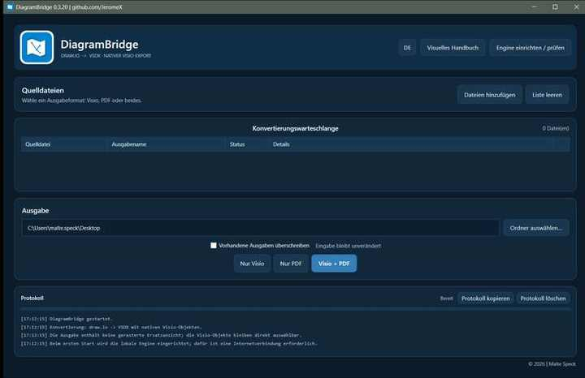
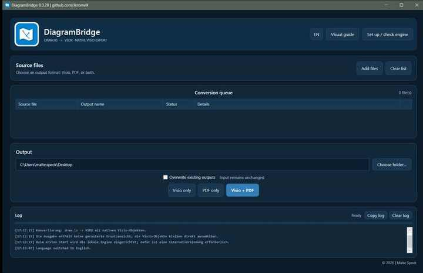
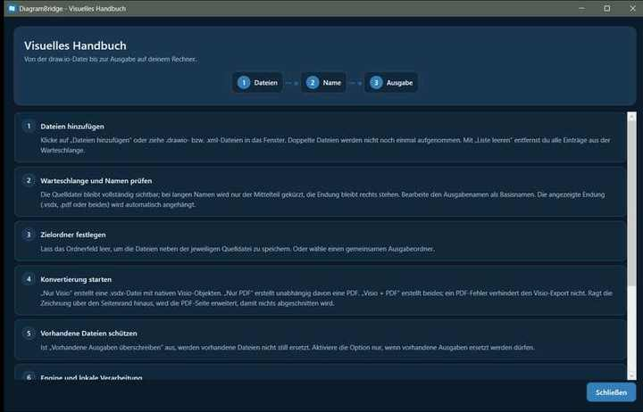
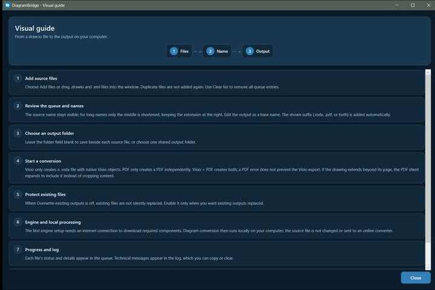

# DiagramBridge 0.3.20

**Draw.io → Native Microsoft Visio (VSDX) · PDF Export**

A local Windows desktop converter for turning `.drawio` and draw.io XML diagrams into native Visio documents and PDF files.

[Deutsch](#deutsch) · [English](#english) · [Screenshots](#screenshots)

---

## Deutsch

### Überblick

**DiagramBridge** konvertiert draw.io-/diagrams.net-Diagramme lokal auf einem Windows-Rechner in Microsoft-Visio-Dateien (`.vsdx`) und/oder PDF-Dateien. Der Visio-Export verwendet native Visio-Objekte. Es wird keine gerasterte Abbildung des Diagramms als Ersatzebene in die VSDX-Datei eingefügt.

Die Anwendung ist als Windows-x64-ZIP-Release vorgesehen. Das Programm wird ohne separaten Setup- oder MSI-Installer bereitgestellt. Die Konvertierungs-Engine wird beim ersten Start lokal eingerichtet und anschließend aus dem lokalen Anwendungscache verwendet.

**Download:** Das Programmarchiv wird als ZIP-Datei im Bereich [GitHub Releases](https://github.com/JeromeX/DiagramBridge/releases) bereitgestellt. Dieses Repository dokumentiert die veröffentlichte Anwendung; eine Entwickler- oder Build-Anleitung ist nicht Bestandteil dieser Dokumentation.

### Funktionen

| Bereich | Funktion |
|---|---|
| Quelldateien | Unterstützt `.drawio` und draw.io-XML (`.xml`). |
| Mehrfachverarbeitung | Mehrere Dateien in einer Konvertierungswarteschlange; Dateien können über den Dateiauswahldialog oder per Drag-and-drop hinzugefügt werden. |
| Duplikate | Bereits eingetragene Quelldateien werden nicht erneut in die Warteschlange aufgenommen. |
| Ausgabenamen | Der vorgeschlagene Basisname kann pro Warteschlangeneintrag bearbeitet werden. Die ausgewählte Dateiendung wird automatisch ergänzt. |
| Zielordner | Gemeinsamen Ausgabeordner auswählen oder das Zielordnerfeld leeren, um neben der jeweiligen Quelldatei zu speichern. |
| Visio | Erstellt `.vsdx` mit nativen Visio-Objekten und übernimmt die Namen der Quelldiagrammseiten. |
| PDF | Erstellt ein PDF mit einer Ausgabeseite je Diagrammseite. Der PDF-Export kann unabhängig vom VSDX-Export ausgeführt werden. |
| Kombinierte Ausgabe | Erstellt VSDX und PDF in einem Durchlauf. Ein PDF-Fehler verhindert nicht automatisch die Fertigstellung des VSDX-Exports. |
| Überschreibschutz | Vorhandene Ausgabedateien werden standardmäßig nicht stillschweigend ersetzt. Das Überschreiben kann ausdrücklich aktiviert werden. |
| Status und Protokoll | Warteschlangenstatus, Detailmeldungen und ein kopierbares technisches Protokoll; Protokolleinträge können gelöscht werden. |
| Visuelles Handbuch | Integrierte Schritt-für-Schritt-Ansicht in Deutsch und Englisch. |

### Ausgabeformate

| Auswahl | Ergebnis | Verhalten |
|---|---|---|
| **Nur Visio** | `.vsdx` | Erstellt ausschließlich eine native Visio-Datei. |
| **Nur PDF** | `.pdf` | Erstellt ausschließlich eine PDF-Datei, unabhängig vom VSDX-Export. |
| **Visio + PDF** | `.vsdx` und `.pdf` | Versucht beide Ausgaben. Ein PDF-Fehler wird als Warnung protokolliert; eine gültige VSDX-Ausgabe bleibt erhalten. |

Der PDF-Export erhält die Abmessungen der Quellseiten, solange der Diagramminhalt innerhalb der jeweiligen Seitengrenzen liegt. Reicht der Inhalt über eine Seitengrenze hinaus, kann die betroffene PDF-Seite erweitert werden, damit der Inhalt nicht abgeschnitten wird. Diese PDF-Anpassung verändert weder die Quelldatei noch die nativen VSDX-Seitenabmessungen.

### Sprache und Benutzeroberfläche

DiagramBridge enthält eine vollständige deutsche und englische Oberflächenterminologie einschließlich Statusmeldungen und visuellem Handbuch.

- Beim ersten Start wird die Sprache anhand der Windows-/Prozess-Anzeigesprache initial gewählt: Deutsch bei Sprachkennung `de`, andernfalls Englisch.
- Der **DE/EN**-Schalter ändert die Sprache unmittelbar.
- Die manuell gewählte Sprache wird gespeichert und bei späteren Starts wiederhergestellt.
- Auch der zuletzt eingestellte Ausgabeordner wird in den Anwendungseinstellungen gespeichert.

Die Einstellungen liegen unter `%LOCALAPPDATA%\DiagramBridge\settings.json`.

### Screenshots

Die folgenden Ansichten zeigen die tatsächliche Programmoberfläche aus Version 0.3.20.

| Deutsches Hauptfenster | Englisches Hauptfenster |
|---|---|
|  |  |

| Visuelles Handbuch – Deutsch | Visual guide – English |
|---|---|
|  |  |

### Datenschutz und lokale Verarbeitung

- Die Diagrammkonvertierung läuft auf dem lokalen Windows-Rechner.
- Die Quelldatei wird für die Verarbeitung in einen temporären Arbeitsordner kopiert; das Original wird nicht verändert.
- Die lokale Editor-Sitzung wird über `127.0.0.1` bereitgestellt.
- Die Browser-Sitzung ist auf lokale Ressourcen begrenzt; externe Browser-Anfragen werden während der Konvertierung blockiert.
- Eine Internetverbindung wird beim erstmaligen Einrichten der Engine zum Abruf der festgelegten Komponenten benötigt.
- DiagramBridge ist kein Online-Konvertierungsdienst. Die Diagramminhalte werden nicht an einen externen Konvertierungsserver übertragen.

### Systemvoraussetzungen

- Windows x64.
- Microsoft Edge oder Google Chrome muss lokal installiert sein.
- Internetverbindung für die erstmalige Einrichtung der lokalen Engine.
- Ausreichend freier Speicherplatz für Engine-Cache, temporäre Arbeitsdateien und Ausgabe.

### Grenzen und Hinweise zur Ausgabequalität

- Die native VSDX-Exportstrecke basiert auf einem adaptierten Upstream-Exportansatz, der dort als Beta beschrieben wird. Eine strukturell gültige VSDX-Datei ist kein Beweis für eine pixelgenaue Darstellung in jeder Visio-Version.
- Die VSDX-Prüfung kontrolliert die Paketstruktur und ausgewählte Inhalte. Sie ersetzt keinen vollständigen visuellen Vergleich in Microsoft Visio.
- Die VSDX-Verarbeitung akzeptiert derzeit Quelldateien mit 1 bis 200 Diagrammseiten.
- Extern verknüpfte Bilder sollten vor dem Export direkt in die draw.io-Datei eingebettet werden. Nicht lokal verfügbare oder von außen referenzierte Bildressourcen können insbesondere den PDF-Export verhindern.
- Die Darstellung einzelner Formen, Schriftarten und Verbindungen kann je nach Diagramminhalt und Visio-Version abweichen. Für wichtige Dokumente sollte das erzeugte Ergebnis in der vorgesehenen Zielanwendung geprüft werden.

### Release und Version

- **Aktuelle dokumentierte Programmversion:** `0.3.20`
- **Verteilungsform:** Windows-x64-ZIP mit dem Programm.
- **Kein separater Installer:** Die Veröffentlichung ist auf das ZIP-Programmarchiv ausgerichtet.
- **Version 0.3.20:** Startfenstergröße auf 1300 × 840 angepasst; die leere Warteschlangenfläche verwendet dieselbe dunkle Oberfläche wie das Warteschlangenpanel.

### Drittanbieter und Lizenzen

**DiagramBridge ist dein eigenständiges, proprietäres Produkt.** Die originale WPF-Anwendung, Oberfläche, Lokalisierung, Konvertierungssteuerung, Engine-Einrichtung und VSDX-Prüflogik sind separate DiagramBridge-Projektarbeit und werden durch dieses Dokumentations-Repository nicht als Open Source freigegeben.

Ein abgegrenzter Teil der Exportlogik (`export_vsdx.js`) adaptiert den lokalen Exportansatz aus [Larry-Labs/drawio-to-visio](https://github.com/Larry-Labs/drawio-to-visio). Für dieses adaptierte Exportmaterial gilt Apache License 2.0. Die vollständige Lizenz liegt unter [licenses/Apache-2.0-Larry-Labs-Exporter.txt](licenses/Apache-2.0-Larry-Labs-Exporter.txt).

Node.js, diagrams.net und Playwright werden bei der erstmaligen Engine-Einrichtung separat bezogen und behalten ihre jeweiligen Upstream-Lizenzen. Sie werden nicht dadurch zu deinem Eigentum, dass DiagramBridge sie verwendet.

Siehe [PROPRIETARY-NOTICE.md](PROPRIETARY-NOTICE.md) und [THIRD-PARTY-NOTICES.md](THIRD-PARTY-NOTICES.md).

---

## English

### Overview

**DiagramBridge** converts draw.io / diagrams.net diagrams locally on a Windows computer into Microsoft Visio files (`.vsdx`) and/or PDF files. The Visio export uses native Visio objects. It does not insert a rasterized picture of the diagram as a fallback layer in the VSDX document.

The application is intended to be distributed as a Windows x64 ZIP release. No separate setup wizard or MSI installer is part of the intended release format. The conversion engine is initialized locally on first launch and then reused from the local application cache.

**Download:** The application archive is published as a ZIP file in [GitHub Releases](https://github.com/JeromeX/DiagramBridge/releases). This repository documents the released application; developer and build instructions are intentionally not part of this documentation.

### Features

| Area | Feature |
|---|---|
| Input files | Supports `.drawio` and draw.io XML (`.xml`). |
| Batch processing | Multiple files in one conversion queue; files can be added through the file picker or drag-and-drop. |
| Duplicate handling | A source file already in the queue is not added a second time. |
| Output names | The proposed base name can be edited for each queue entry. The selected output extension is appended automatically. |
| Output folder | Select one shared output folder or clear the folder field to save beside each source file. |
| Visio | Creates `.vsdx` with native Visio objects and restores the source diagram page names. |
| PDF | Creates a PDF with one output page per diagram page. PDF export can run independently of VSDX export. |
| Combined output | Creates VSDX and PDF in one run. A PDF error does not automatically prevent the VSDX export from completing. |
| Overwrite protection | Existing output files are not silently replaced by default. Overwriting can be explicitly enabled. |
| Status and log | Queue status, per-item details, and a copyable technical log; log entries can be cleared. |
| Visual guide | Built-in step-by-step guide in German and English. |

### Output formats

| Selection | Result | Behaviour |
|---|---|---|
| **Visio only** | `.vsdx` | Creates a native Visio file only. |
| **PDF only** | `.pdf` | Creates a PDF independently of the VSDX export. |
| **Visio + PDF** | `.vsdx` and `.pdf` | Attempts both outputs. A PDF error is logged as a warning; a valid VSDX output is retained. |

PDF export preserves source page dimensions while the drawing content remains within the declared page boundaries. If drawing content extends beyond a page boundary, the affected PDF page can be expanded so the content is not clipped. This PDF adjustment does not modify the source file or the native VSDX page dimensions.

### Language and user interface

DiagramBridge provides German and English interface text, including status messages and the visual guide.

- On first launch, the initial language follows the Windows/process UI language: German for language identifier `de`, English otherwise.
- The **DE/EN** switch changes the interface language immediately.
- The manually selected language is saved and restored on subsequent launches.
- The last selected output folder is also stored in the application settings.

Settings are stored at `%LOCALAPPDATA%\DiagramBridge\settings.json`.

### Privacy and local processing

- Diagram conversion runs on the local Windows computer.
- The source file is copied to a temporary working folder; the original is not modified.
- The local editor session is hosted on `127.0.0.1`.
- The browser session is restricted to local resources; external browser requests are blocked during conversion.
- An internet connection is needed on first engine setup to retrieve the pinned components.
- DiagramBridge is not an online conversion service. Diagram content is not transferred to an external conversion server.

### System requirements

- Windows x64.
- Microsoft Edge or Google Chrome installed locally.
- Internet access for the initial local engine setup.
- Sufficient free storage for the engine cache, temporary working files, and output files.

### Limitations and output-quality notes

- The native VSDX export path is based on an adapted upstream export approach that is described as beta by that upstream project. A structurally valid VSDX file does not guarantee pixel-perfect rendering in every Visio version.
- VSDX validation checks package structure and selected content. It is not a full visual comparison in Microsoft Visio.
- The current VSDX processing path accepts source files containing 1 to 200 diagram pages.
- Externally linked images should be embedded directly in the draw.io file before export. Image resources that are not locally available or that are referenced externally may prevent PDF export in particular.
- The rendering of individual shapes, fonts, and connectors can vary with diagram content and Visio version. Important documents should be reviewed in the intended target application.

### Release and version

- **Current documented application version:** `0.3.20`
- **Distribution format:** Windows x64 ZIP containing the application.
- **No separate installer:** The release process is intended to publish the program ZIP archive.
- **Version 0.3.20:** Initial window size adjusted to 1300 × 840; the empty queue viewport now uses the same dark surface as the queue panel.

### Third-party components and licences

**DiagramBridge is your independent, proprietary product.** The original WPF application, user interface, localization, conversion orchestration, engine setup, and VSDX validation logic are separate DiagramBridge project work. This documentation repository does not release those original application components as open source.

A limited part of the export logic (`export_vsdx.js`) adapts the local export approach from [Larry-Labs/drawio-to-visio](https://github.com/Larry-Labs/drawio-to-visio). The adapted exporter material is subject to the Apache License 2.0. The complete license is provided at [licenses/Apache-2.0-Larry-Labs-Exporter.txt](licenses/Apache-2.0-Larry-Labs-Exporter.txt).

Node.js, diagrams.net, and Playwright are obtained separately during first-time engine setup and remain subject to their respective upstream licenses. Using these components does not make them your intellectual property.

See [PROPRIETARY-NOTICE.md](PROPRIETARY-NOTICE.md) and [THIRD-PARTY-NOTICES.md](THIRD-PARTY-NOTICES.md).

---

**DiagramBridge 0.3.20** · © 2026 Malte Speck · [GitHub](https://github.com/JeromeX)

